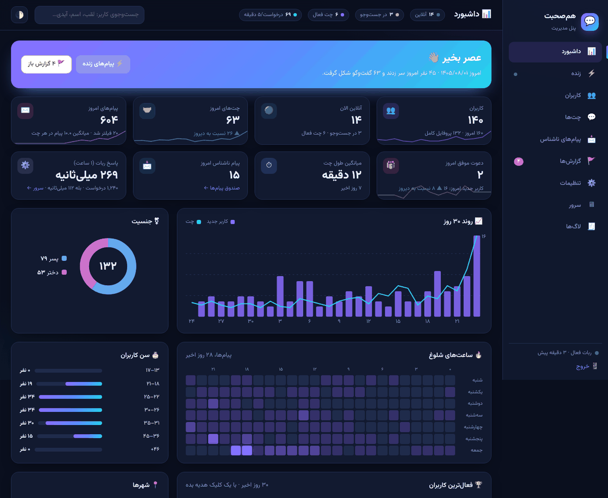

# هم‌صحبت (Hamsobat): anonymous random chat for Bale

A Bale bot in plain PHP + MySQL. Everything happens inside Bale: messages, the reply keyboard (the buttons that replace the phone keyboard) and glass (inline) buttons. There is no website and no Mini App, and users never type commands except Bale's own `/start`.

**Features**
- **Profile:** registration one question at a time; Jalali birth date (only the age is shown).
- **Matching:** before **every** search the bot asks "who do you want to talk to?" (girl / boy / either, last choice marked ✓). Preferences are respected in both directions, and there's no matching with people you blocked.
- **Anonymous relay:** text, photo, voice, audio, sticker, video and GIF.
- **In chat:** next, end, profile view (with an optional "someone viewed your profile" notice), block and report.
- **Access:** a required channel (checked on the server) and a required first referral.
- **Quota:** daily free chats plus credits earned from referrals.
- **Anonymous inbox:** a personal link (`?start=msg…`) that opens anonymous conversations with replies.
- **Admin:** a **web admin panel** (`panel/`) and commands inside Bale, plus a cleanup that runs without cron.
- **Birth date:** chosen with a Shamsi picker made of buttons (year → month → day); typing still works.



---

## 1. Files

```
hamsobat/
  webhook.php        Bale posts updates here (secret ?k=…)
  migrate.php        creates the tables from database.sql (safe to re-run)
  check.php          self-test + setwebhook (admin password)
  config-example.php copy to config.php (never commit config.php)
  database.sql       the schema (also importable with phpMyAdmin)
  database.php       PDO wrapper: utf8mb4, {table} prefix, transactions with deadlock retry
  bootstrap.php      loads everything (no Composer)
  handlers/          start, profile, matching, chat, referral, inbox, settings
  services/          BaleApi, MatchingService, QuotaService, ReferralService, MessageRelay,
                     Requirements, Moderation, Settings, Ui (all labels), Text (validation, Jalali) …
  admin/commands.php admin commands
  panel/             web admin panel: index.php (pages), api.php (live JSON), media.php (photos/voices
                     from Bale), views/, assets/ (CSS, JS, Vazirmatn font — no CDN)
  cron/              cleanup.php (every minute, optional), daily_tasks.php (daily, optional)
  storage/logs/      JSON log files (web access denied)
  tests/             run.php, concurrency.php, e2e/ (not uploaded to the host)
```

## 2. Install (shared host, no SSH)

1. **Database:** create a MySQL/MariaDB database and user in the host panel, with charset `utf8mb4`.
2. **Upload:** upload `hamsobat.zip` and extract it, e.g. into `public_html/hamsobat/`. The host needs PHP 8.2+ with the `curl`, `pdo_mysql` and `mbstring` extensions.
3. **Config:** copy `config-example.php` to `config.php` and fill in:
   - **database:** host, name, user, password
   - **bale.bot_token**, and **bale.bot_username** without `@`
   - **bale.webhook_secret**, **admin.password**, **cron_secret:** long random strings, all different
   - **admin.ids:** your Bale user id. Not known yet? Leave it, finish the steps, send `/start` to the bot, then open `check.php`. It lists the newest users with their Bale ids.
4. **Tables:** open `https://YOUR.SITE/hamsobat/migrate.php?pass=ADMIN_PASSWORD`. You should see ✔ for 25 tables.
5. **Self-test:** open `https://YOUR.SITE/hamsobat/check.php?pass=ADMIN_PASSWORD`. Every line should be ✔.
6. **Webhook:** open `https://YOUR.SITE/hamsobat/check.php?pass=ADMIN_PASSWORD&setwebhook=1`. The bot now runs from this folder.
7. **Required channel:**
   - Make the bot an **admin** of the channel; Bale only lets admins check who is a member.
   - **Easiest setup:** forward any post from the channel to the bot and tap **✅ همین کانال اجباری شود**. That stores the channel's numeric id and link.
   - **Or** send `/setchannel @your_channel https://ble.ir/your_channel` to the bot. It runs a diagnosis right away; `/channeltest` repeats it.
   - To turn the requirement off: `/setchannel off`.
8. **Admin panel:** open `https://YOUR.SITE/hamsobat/panel/`. Enter the admin password; the bot then sends a 6-digit code to your Bale account (`admin.ids`). Enter it and you're in.
9. **Optional cron:** call `https://YOUR.SITE/hamsobat/cron/cleanup.php?k=CRON_SECRET` every minute, from the panel's cron or a free external cron service. Without it, the same work runs inside the webhook. On PHP-FPM or LiteSpeed hosts (almost all), "nobody found" still arrives on time; on others it arrives with the next update.

HTTPS is required by Bale for webhooks.

### Updating to 1.3.2 (test accounts)
Replace the files (keep `config.php`); no `migrate.php`. New setting `test_accounts` (panel ⚙️ → 👤 کاربران): list the Bale ids of your test accounts and they can be matched with each other whatever their age. Everyone else keeps the under-18 / 18+ rule. Empty the list when you finish testing.

### Updating to 1.3.1 (search fixes)
Replace the files (keep `config.php`). No table changes: `migrate.php` is not needed.

- **A search no longer dies silently.** Before, a search that ran out was only noticed when someone else pressed a button: that person was queued alone and the first searcher got "nobody found" at that moment, so two people a little apart never met. Now a search counts until its user has actually been told, and after its answer to Bale the webhook stays (one request at a time) to send "nobody found" on time.
- **Search time 30 s → 120 s by default.** If your `config.php` has `'search_timeout_seconds' => 30`, change it, or set it in the panel (⚙️ → 🎟 سهمیه و جست‌وجو).
- **Faster buttons:** the periodic work (timeouts, cleanup, "send to all") runs after Bale has its answer, not before the user's update; the search buttons stop spinning at once.
- **Referral retry:** the hourly retry checks the newest pending friends (last 14 days) instead of the same 30 oldest ones forever.
- **Testing with two accounts?** `rematch_cooldown_minutes` (default 10) keeps the same two people apart after a chat. Set it to 0 while you test.

### Upgrading a live bot to 1.3 (no downtime)
Same steps as 1.2 below. `migrate.php` adds two new tables (`user_accounts`, `broadcasts`) and changes nothing that exists; until it has run, the bot simply skips the features that need them.

**What's new in 1.3:**
- **"Send to all" and "send to one" in the panel (📢):** text plus an optional link button, an audience (everyone / complete profiles / active in 7 or 30 days / girls / boys / admins only), a test send to yourself first, and pause, resume or cancel. A broadcast is a queue sent in small batches, with nobody getting it twice. It moves fastest while the page is open, and also continues with the bot's normal work and cron.
- **Channel check fixed:** Bale answers "no such group or user" both when the setup is wrong and when a user simply hasn't joined. The bot now checks itself (is it an admin of the channel? `getChat` gives the channel's numeric id) and treats the answer as "not joined" when the setup is fine. Otherwise it tells you exactly what to fix.
- **Setting up the channel:** forward any post from the channel to the bot and tap "✅ همین کانال اجباری شود", or use the settings page (🧪 test, channels the bot has seen). The bot also tells you when it's added to a channel.

### Upgrading a live bot to 1.2 (no downtime)
1. Upload the new zip over the old folder. Your `config.php` stays.
   - The bot keeps running even before step 2: code that needs the new table checks for it first and simply skips it until it exists.
2. Open `migrate.php?pass=…`.
   - It adds `user_accounts`, and also v1.1's 3 tables if you skipped 1.1.
   - It never changes or drops existing tables, so users, chats and settings stay as they are, and the old files still work on this database.
3. That's all. Each user's real Bale name and @username fill in the next time they send something.
   - Users who don't come back are looked up with `getChat`, 30 per hourly cleanup.
   - The user page also has a **🔄 دریافت از بله** button.

### Upgrading from 1.0 to 1.1 (admin panel)
1. Upload the new zip over the old folder. It contains no `config.php`, so yours stays.
2. Run `migrate.php?pass=…` once. It **only adds** 3 new tables (`request_metrics`, `user_perks`, `admin_log`); existing tables are not touched. That means the 1.0 files still work on the same database if you ever roll back.
3. Optional, in `config.php`: `'panel' => ['two_factor' => true, 'session_hours' => 12]`. Without it these defaults apply.
4. Open `panel/` and log in.

## 3. Configuration

`config.php` holds the secrets and the starting values. Everything else is a **setting**: the admin changes it from inside Bale with `/set name value`, and the saved value wins over `config.php`. Send `/settings` to see them all with explanations. The most important ones:

| setting | default | meaning |
|---|---|---|
| `daily_free_chats` | 5 | free *matched* chats per day (searching costs nothing) |
| `required_referrals` | 1 | qualified referrals needed before the first chat (0 = off) |
| `referral_reward_credits` | 3 | extra chats per qualified referral, used after the daily free ones |
| `referral_requires_channel` | 1 | a referral counts only when the friend also joined the channel |
| `referral_daily_reward_cap` | 20 | rewarded referrals per inviter per day |
| `required_channel` / `channel_link` / `require_channel` | – | the channel gate (`/setchannel`) |
| `search_timeout_seconds` | 120 | how long one search waits |
| `rematch_cooldown_minutes` | 10 | the same two people are not matched again for this long (0 while testing with two accounts) |
| `chat_idle_minutes` | 30 | a chat without messages ends by itself (0 = never) |
| `min_age` / `max_age` | 18 / 80 | registration age limits. Under-18s and adults are **never** matched, even if you lower `min_age` |
| `test_accounts` | empty | your own test accounts (Bale numeric ids, comma-separated). The under-18 / 18+ rule is off **only between two of them**, so you can test with accounts of any age. Real users are always separated |
| `block_links` | 1 | blocks links, @usernames and phone numbers in chats, bios and the inbox |
| `allowed_types` | text,photo,voice,audio,sticker,video,animation | what can be sent in a chat (documents are off) |
| `message_retention_days` | 7 | chat messages are kept this long for report review, longer only while a report is open |
| `msg_rate_per_minute`, `inbox_rate_per_hour`, `report_rate_per_day` | 30, 10, 10 | anti-spam limits |
| `auto_suspend_reports` | 3 | number of different reporters within 24 h that triggers a 24 h suspension |
| `feature_inbox`, `feature_media`, `feature_profile_view_notify`, `maintenance` | on, on, on, off | feature switches |

Examples: `/set daily_free_chats 7`, `/feature inbox off`, `/maintenance on`.

## 4. Admin panel (web) and admin commands

**Web panel** (`https://YOUR.SITE/hamsobat/panel/`). It's in Persian, works in dark and light themes and on a phone, and loads nothing from outside your host.

| page | what you see and do |
|---|---|
| 📊 **Dashboard** | Users, online now, people searching or chatting, chats and messages today vs yesterday, average chat length, 30-day trend, busiest hours (weekday × hour heatmap), gender, ages, cities, interests, bot response time. The **most active users**, each with a one-click **🎁 +50 credits** and **💎 7 days unlimited**. The latest chats. |
| ⚡ **Live** | Every message relayed between users appears a few seconds later (sender ➜ receiver, text, photo, voice). Can be paused. Shows active chats and live counters. |
| 👥 **Users** | Search by nickname, name, city, **real Bale name or @username**, Bale id or #id. Filters: online, incomplete, suspended, no-referral, unlimited, gender. Sort by newest, last seen, most chats, most messages, most invites, most credits. |
| 👤 **User** | **Bale account:** real name and @username (links to the Bale profile), plus old names if they changed them. **Profile:** photo, display name, nickname, birth date (Shamsi + age), gender, wanted gender, city, bio, interests, privacy, joined, last seen, inviter, links. **History:** activity chart, all chats, invited friends, credit history, reports. **Actions:** gift credits (+10 … +1000 or any number), unlimited chats (1 / 7 / 30 days / forever), unlock without referral, refill today's free chats, message the user from the bot, end their chat, suspend (1 h / 24 h / 7 days / forever), rename, delete photo, bio or city. |
| 💬 **Chats** | All chats, or only active or reported ones. Opening one shows **the full conversation as chat bubbles**: photos, voice players and videos inline, filtered messages marked in red, and live updates while the chat is still active. |
| 📩 **Anonymous inbox** | Every anonymous message, with its real sender visible only to you, and each conversation as a thread. |
| 📢 **Send message** | **Send to all** (ads, news): text and an optional link button. Audience: everyone, complete profiles, active in 7 or 30 days, girls, boys, or admins only. A live preview, a test send to yourself, and progress bars with pause, resume and cancel. **Send to one:** #id, nickname, @username or Bale id. |
| 🚩 **Reports** | Each report with its reason, the last messages, how many people reported that user, and suspend / resolve / dismiss buttons. |
| ⚙️ **Settings** | Every setting in groups, with switches, numbers and media-type chips. Changed values are marked; a "save all" bar appears when you edit. |
| 🖥 **Server** | **Host:** gauges for CPU load, server RAM (and your account's RAM limit if the host shows it), disk, OPcache. **Bot performance:** requests per minute and hour, average and maximum response time, slow requests, errors, Bale API latency and a live ping, DB queries per request. **Health:** webhook status, pending updates, last webhook error. **Info:** PHP, extensions, MySQL version, connections, size and rows of every table. **Buttons:** "connect the bot to this folder" (setWebhook) and "run cleanup". |
| 🧾 **Logs** | Errors (secrets redacted) and an audit log of every panel action (who, what, when, IP). |

**Security:**
- **Login:** the admin password, then a code from the bot in Bale. Turn the code off with `panel.two_factor = false`.
- **Brute force:** 5 wrong tries per IP per 15 minutes.
- **Session:** the cookie is HttpOnly and SameSite=Strict, and you're logged out after 12 idle hours.
- **Forms:** every form carries a CSRF token.
- **Headers:** a strict Content-Security-Policy, and no framing.
- **Media:** fetched with the bot token on the server; the token never reaches the browser.
- **Users are told:** the bot's guide says the admin can see their Bale name and @username and their messages, and that messages are deleted after `message_retention_days`. Raise that setting if you want to keep chats longer.
- **Never shown to other users:** the real Bale account is only stored in `{user_accounts}`, which only the panel and the admin `/user` command read. A test checks that partners and inbox recipients never receive it.

**Bot commands** (in Bale, only for `admin.ids`). Same powers, for when you're away from a computer:

- **Overview:**
  - `/admin`: help and stats
  - `/stats`
  - `/settings`, `/set`, `/feature`, `/maintenance`
  - `/setchannel`
- **Reports:**
  - `/reports`: open reports
  - `/report <n>`: the reason, the last messages of that chat (🔴 reported, 🔵 reporter), and buttons: suspend 24 h, suspend permanently, done, dismiss
- **Users:**
  - `/user <id|nickname>`: shows the Bale id, for admins only
  - `/suspend <user> [hours]`, `/unsuspend <user>`
  - `/credit <user> <n>`
  - `/unlock <user>`: lets them chat without a referral, useful for the first users
- **Maintenance:** `/errors` (recent errors, secrets redacted) and `/cleanup`.

Admins skip the channel and referral requirements, so the owner can test right away.

## 5. How it works

- **Main menu (reply keyboard):** `🔎 پیدا کردن هم‌صحبت` / `👤 پروفایل من` · `📥 پیام‌های ناشناس` / `👥 دعوت دوستان` · `⚙️ تنظیمات`.
  - **Searching:** the keyboard switches to `❌ لغو جست‌وجو`.
  - **Chatting:** `➡️ نفر بعدی` · `🏁 پایان چت` / `👤 دیدن پروفایل` · `🚫 مسدود کردن` · `🚩 گزارش`.
  - **Label matching:** labels are matched ignoring emoji variation selectors and half-spaces (`services/Ui.php`).
- **Matching (`services/MatchingService.php`):**
  - Every queue or chat change runs in one transaction that first locks the `matching` row of `{locks}` (`SELECT … FOR UPDATE`). Two webhooks can't take the same waiting user, and two people who search at the same moment are matched instead of both waiting.
  - `{active_chats}` has `user_id` as PRIMARY KEY, so "one chat per user" is also a database rule.
  - The chat row, the removal from the queue and the quota spend for **both** users commit together. A chat is counted only when two people are actually matched.
- **Relay (`services/MessageRelay.php`):**
  - The bot re-sends each message itself (`sendMessage` / `sendPhoto` … with Bale's `file_id`), so the receiver sees no name or id.
  - `copyMessage` (also anonymous) is only a fallback. `forwardMessage` is never used between users.
  - If the partner blocked the bot, the chat ends. If that happens right at matching time, both get their chat credit back.
- **Referrals (`services/ReferralService.php`):**
  - Only a new account counts: one created through the link, or created less than 60 minutes ago without a finished profile.
  - One inviter per account; self-referral is impossible.
  - A referral qualifies after the friend finishes the profile (and joins the channel, if that setting is on).
  - The reward is a ledger row keyed on the referral. It can never be given twice, even if Bale re-sends the update.
- **Anonymous inbox:**
  - Opening an `msg` link never counts as a referral.
  - Each visitor ↔ owner pair is a separate anonymous session.
  - If the owner is in a random chat, only a short notice arrives; the content waits in the inbox, so it can't be mistaken for the chat partner.
  - A blocked sender is not told. Their messages are stored as blocked and never delivered.
- **Privacy:**
  - **Never shown to other users:** Bale ids, real names (the display name is chosen by the user), exact birth dates.
  - **Optional:** city, bio and photo can each be hidden in Settings.
  - **Retention:** chat messages are kept for `message_retention_days` for report review, then deleted. The guide tells users this.
- **Idempotency:** each update's `update_id` + body hash is stored; a re-delivered update is ignored.
- **Performance metrics:**
  - Each webhook request records its duration, Bale calls and latency, DB queries and peak memory into a per-minute row (`{request_metrics}`, kept 14 days).
  - That's one cheap upsert per request. The Server page draws its charts from it.
- **Unlimited chats** (`{user_perks}`): a gift from the admin that the quota checks. Chats are still counted, but never limited.
- **Search timeouts and idle chats:** after each update has been handled (and Bale has its answer, where PHP-FPM or LiteSpeed allow it), `webhook.php` runs a throttled cleanup (at most every 10 s). `cron/cleanup.php` does the same on demand.
  - **On-time "nobody found" without cron:** one request at a time (a lease in `{settings}`) stays after its answer, sleeps until the next search runs out and tells that user. It stays at most the search time + 15 s (60–300 s), wakes every ≤ 20 s and uses no CPU while it sleeps.
  - A search that ran out still matches until its user has been told (at most 10 minutes), because their screen still says "searching".

## 6. Bale API: what was verified

docs.bale.ai could not be reached from the build machine. The methods were checked against Bale SDKs that implement docs.bale.ai, and against the live GPT_BOTble bot.

| feature | status |
|---|---|
| `sendMessage`, inline buttons + `answerCallbackQuery`, deep link `https://ble.ir/<bot>?start=<payload>` | ✔ used in the live bot |
| `getChatMember`, `copyMessage`, `editMessageText`, `editMessageReplyMarkup`, `sendPhoto/Voice/Audio/Video/Animation/Document/Sticker` | listed by the SDKs that implement docs.bale.ai |
| reply keyboard (`keyboard`, `resize_keyboard`, `remove_keyboard`), inline `url` buttons | shown in the SDK examples |
| `getChatMember` status names (`member`, `administrator`, `creator`, `left`, `kicked`) | Telegram names, assumed |
| `my_chat_member` update when a user blocks the bot | handled if Bale sends it; otherwise the next failed send ends the chat |
| colored buttons | not used |
| a native **date picker** for bots | **does not exist** in Bale's bot API: reply buttons can only share a contact or a location, and nothing returns a date. The bot therefore uses a Shamsi picker made of glass buttons (year → month → day, edited in one message). Every button has a visible label, because Bale refuses empty ones, and no `is_persistent` is sent, because Bale rejects it as INVALID INPUT ([a Bale bot project ran into both](https://github.com/ftmehoseini/RastaTTBot/pull/1)). |

The code always sends form fields first (like the old working bot), then JSON as a fallback.

**First test on the real bot (10 minutes, two Bale accounts):**
1. `/start` → welcome + the `📝 تکمیل پروفایل` keyboard appears.
2. Register both accounts. Use `/unlock` for the second one, or invite it with the first account's link.
3. Both press `🔎 پیدا کردن هم‌صحبت` → both get "هم‌صحبت پیدا شد" and the chat keyboard.
4. Send text, a photo and a voice message: they arrive **without** "forwarded from".
5. `/setchannel …` and check that a non-member sees the join button, and a member passes.
6. Open your `📥 پیام‌های ناشناس` link from the other account and send something.

If any step fails, send `/errors` to the bot. It shows Bale's exact answer.

## 7. Deployment checklist

- [ ] PHP 8.2+, `curl`, `pdo_mysql`, `mbstring` (check.php)
- [ ] Database created with `utf8mb4`
- [ ] `config.php` filled; secrets long, random and different; `admin.ids` set
- [ ] `migrate.php` → 20 tables ✔
- [ ] `check.php` → everything ✔ (token, username, tables, log folder)
- [ ] `setwebhook=1` → ✔ (HTTPS)
- [ ] Bot is an admin of the required channel; `/setchannel` reports ✔
- [ ] The first-test list above, on the real bot
- [ ] `panel/` → log in with password + Bale code → Server page: everything green
- [ ] Optional: cron for `cron/cleanup.php` (every minute) and `cron/daily_tasks.php` (daily)
- [ ] No old helper files on the host (file editors, upload forms)
- [ ] `tests/` is not uploaded (the zip doesn't contain it)

**Upgrades and rollback:**
- A new version that changes tables uses a new `table_prefix` (`hs2_`) in a new folder, then `migrate.php` and `setwebhook=1` there.
- Rollback = `setwebhook=1` from the old folder.
- `migrate.php` never drops or alters anything.

## 8. Tests

They need a MySQL/MariaDB database whose name contains `test` (and `e2e` for the end-to-end run). The defaults are `127.0.0.1:3307`, user `hs`/`hs`; override them with `HS_TEST_DB_*` environment variables.

```sh
php tests/run.php              # 325 checks (incl. channel diagnosis and broadcast): validation, registration, date picker, referrals + abuse,
                               # channel gate, quota boundaries, unlimited, matching rules, asking who to
                               # talk to on every search, block, relay, reports, inbox, admin, metrics,
                               # every panel query and action, Bale account capture (never leaked),
                               # running before migrate.php (live update) and the getChat backfill
php tests/concurrency.php 40   # 50 parallel processes searching at once: invariants hold
php tests/e2e/run_e2e.php      # 84 checks over HTTP + fake Bale: webhook.php, migrate.php, check.php, cron,
                               # panel login with the Bale code, every page, CSRF, actions, live API, media
# Preview the panel with demo data (test database only):
HAMSOBAT_CONFIG=tests/e2e/state/config.php php tests/demo_seed.php
```
